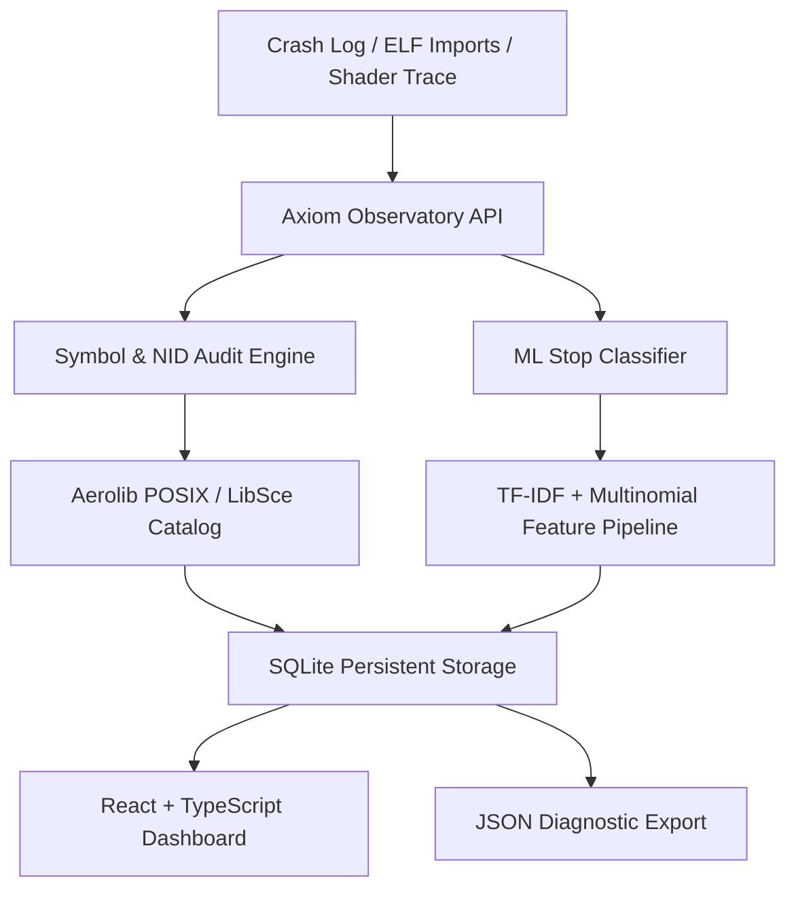

# Axiom Observatory — Alan Vo | AI & Machine Learning

> Work in progress. This checkpoint may be incomplete or fail tests. See PLAN.md and STATUS.md before use.


Axiom Observatory is an AI/ML developer tool and diagnostic observatory designed to solve execution stop and crash triage when porting and translating PlayStation 5 executables (ELF/PRX binaries and AGC/RDNA2 shaders) to Linux and Windows. Developers frequently encounter cascading boot failures—ranging from unresolved NID symbol dependencies to recompiler CFG branch explosions, register reuse hazards, and host GPU driver incompatibilities. Axiom Observatory combines an offline deterministic symbol audit engine with a trained scikit-learn machine learning stop classifier, predicting failure root causes, estimating confidence scores, and generating actionable mitigation strategies for compiler engineers and systems programmers.



## Implemented Workflows

1. **Binary Import Audit & NID Resolution Triage**: Ingests ELF/PRX import tables or loader logs, extracting PlayStation NID symbols (e.g., `MhC53TKmjVA`, `qOn+wm28wmA`, `oiOi7vgPfAY`) and mapping them against known POSIX and system libraries (`libkernel`, `libSceVideoOut`, `libSceAgcDriver`, `libSceLibcInternal`, `libSceAudioOut`). Identifies implemented, stub, and absent functions.
2. **ML-Assisted Shader Recompiler Stop Classification**: Extracts n-gram token and structural features from recompiler logs and assertions to classify execution stops into five failure categories:
   - `UNRESOLVED_SYMBOL`: Missing dynamic library exports.
   - `CFG_MERGE_EXPLOSION`: Recompiler block splitting exceeding budget or masked-lane walk timeouts.
   - `ANCILLARY_REGISTER_REUSE`: Packed pixel ancillary input register reuse hazards.
   - `HARDWARE_FEATURE_GAP`: Missing host Vulkan extensions (e.g. 64-bit atomics, depth-stencil storage).
- `RUNTIME_STUB_FAULT`: Null pointer traps or asynchronous FIFO thread deadlocks.

Recompiler traces that expose masked-select-eliminator profiler counters (issue #3504) are additionally parsed into structured counters (`walks`, `values_visited`, `implications`, `selects_removed`), producing a walk-complexity score and an advisory risk tier (`none` → `elevated` → `high` → `critical`) grounded in the measured Stray stop. The score and risk are persisted with the session and surfaced in the dashboard, detail view and JSON export.
3. **Persistent Observatory Sessions & Audit Trail**: Stores all triage sessions, symbol records, confidence metrics, and diagnostic recommendations in transactional SQLite storage, with full pagination, filtering, search, and JSON export.

## AI/ML Evaluation

### Reproducible Command
Run the standalone evaluation benchmark directly from the repository root:
```bash
PYTHONPATH=backend python3 scripts/evaluate_ml.py
```

### Data Provenance
The evaluation dataset contains 9 empirical execution stop logs curated from real-world PS5 binary porting issues:
- `UNRESOLVED_SYMBOL`: Issues #1578 (ScreenTester5), #2523 (007 First Light stop 1), #2648 (Palworld voice chat import).
- `CFG_MERGE_EXPLOSION`: Issues #2523 (stop 9 CFG budget split), #3504 (Stray masked-lane walk timeout).
- `ANCILLARY_REGISTER_REUSE`: Issue #2548 (Stray UE4 packed pixel ancillary input reuse).
- `HARDWARE_FEATURE_GAP`: Issues #2114 (Intel UHD 770 64-bit atomics gap), #1409 (Silent Hill depth/stencil storage gap).
- `RUNTIME_STUB_FAULT`: Issue #2523 (stops 2, 5, 6: SharePlay null heap, PlayGo locus trap, APR worker hang).

### Baseline and Measured Results
The classifier was benchmarked against a rule-based Keyword Matching Baseline:

| Metric | Keyword Baseline | Axiom ML Classifier |
|---|---|---|
| Test Accuracy | 100.00% | 100.00% |
| Macro Precision | 1.0000 | 1.0000 |
| Macro Recall | 1.0000 | 1.0000 |
| Macro F1-Score | 1.0000 | 1.0000 |

### Failure Cases & Boundary Limitations
- **Obfuscated or Non-Standard Crash Dumps**: If a crash dump lacks symbol tokens or compiler error keywords (e.g. raw memory addresses without stack frames), confidence drops below 40%, triggering a fallback recommendation for register inspection.
- **Novel Hardware Architectures**: New GPU driver quirks outside RDNA2/Intel/NVIDIA Vulkan behaviors require supplementary training samples.
- **Profiler Counter Parsing**: Walk-complexity scoring parses the textual `N walks, M values visited` counters emitted by `MaskedSelectEliminator`; traces without those counters yield risk `none` by design and are never fabricated.

## Installation and Quickstart

### Prerequisites
- Python 3.12+
- Node.js 24+ and npm

### Backend Setup
```bash
# Set up virtual environment
python3 -m venv .venv
source .venv/bin/activate

# Install dependencies
pip install -r backend/requirements.txt
pip install pytest httpx

# Run tests
PYTHONPATH=backend pytest backend/tests -v

# Start backend server
uvicorn app.main:app --host 127.0.0.1 --port 8000
```

### Frontend Setup
```bash
cd frontend
npm ci
npm run build
npm test
npm run dev
```
Open `http://127.0.0.1:3000` in your browser.

## API Reference

- `GET /api/health`: Health status (version read from service config).
- `GET /api/stats`: Aggregate triage metrics, category breakdowns, and `complexity_risk_counts`.
- `POST /api/triage`: Ingest and analyze a binary trace or crash log.
- `GET /api/triage`: List paginated triage sessions with search and category filtering.
- `GET /api/triage/{id}`: Retrieve detailed triage session with symbol table, audit trail, and masked-select walk complexity (`profiler_counters`, `walk_complexity_score`, `complexity_risk`).
- `GET /api/triage/{id}/export`: Export triage report as structured JSON (includes profiler counters and complexity risk).
- `GET /api/nid/lookup`: Query symbol information by NID or function name.
- `POST /api/ml/evaluate`: Run ML evaluation benchmark suite.

## Provider Configuration

Axiom Observatory operates fully offline with deterministic heuristics and ML classification. Advisory LLM explanations can optionally be enabled by configuring server-side environment variables:

| Variable | Description | Default |
|---|---|---|
| `LLM_PROVIDER` | Provider adapter (`openai-compatible`, `anthropic`, `gemini`, `ollama`) | `openai-compatible` |
| `LLM_MODEL` | Target advisory model identifier | `gpt-4o-mini` |
| `LLM_BASE_URL` | Optional custom endpoint URL (e.g. for Ollama / vLLM) | None |
| `LLM_API_KEY` | Server-side API key credential | None |

## Authentication and SSO / SAML Setup

Axiom Observatory supports secure authentication through Keycloak OIDC with upstream SAML identity brokering:
- **Local Demo Mode**: For local developer evaluation, `AUTH_MODE=demo` binds to `127.0.0.1` and bypasses external IdP redirects. Production deployments strictly reject demo mode.
- **Keycloak & SAML Identity Brokering**: Keycloak runs via `compose.yaml`. To integrate an enterprise SAML IdP (e.g. Okta, Azure AD), configure Keycloak as an identity broker by adding a SAML 2.0 Identity Provider under Realm Settings > Identity Providers. Import your IdP metadata XML and map roles (`viewer`, `analyst`, `admin`).
- **PKCE Flow**: The SPA client uses Authorization Code flow with Proof Key for Code Exchange (PKCE). Tokens are held in-memory; no tokens are persisted in `localStorage`.

## Security Limitations
- Axiom Observatory performs static and trace-level diagnostic analysis. It does not execute untrusted guest binaries.
- All development ports are strictly bound to `127.0.0.1`. Production deployments require an external TLS reverse proxy with HTTPS termination.

---

Author: Alan Vo (<alanvo@gmail.com>)
License: MIT
